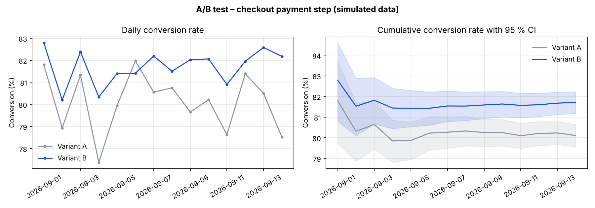

# A/B test on checkout conversion – a reproducible Python experiment

*Ett litet, reproducerbart Python-experiment som visar hur jag analyserar ett A/B-test i en e-handelscheckout: konvertering med konfidensintervall, z-test, segmenterad analys, power/MDE och graf. Datat är simulerat – ingen riktig kunddata.*

**Scenario.** A merchant tests a new version of the payment step (variant B) against today's version (variant A).
The sessions are simulated, but the analysis is the one used in practice:

| Step | What | Why |
|---|---|---|
| 1 | Conversion per variant with Wilson 95 % CI | Behaves better than the plain Wald interval |
| 2 | Two-proportion z-test | Is the difference larger than noise? |
| 3 | CI for the difference (absolute + relative uplift) | A p-value alone says nothing about the size of the effect |
| 4 | Segmented analysis (mobile / desktop) | Overall numbers can hide very different effects per segment |
| 5 | Power / MDE table and required sample size | Decide *before* the test whether the traffic is enough |
| 6 | Daily and cumulative conversion chart | Stability over time, not just the end result |

## Result (seed 2026)

```
A: 80.11%   B: 81.72%   diff: +1.60 pp (95 % CI +0.85 to +2.36 pp)   relative uplift: +2.00%
z = 4.18, p = 0.0000 → statistically significant at the 5 % level
mobile   +2.17 pp (p < 0.001)      desktop  +0.58 pp (p = 0.31)
MDE with ~21 000 sessions per variant: 1.09 pp
```



**Takeaway:** ship B – the uplift is real and comes almost entirely from mobile. Desktop needs a closer look before expecting the same gain there.

## Run it

```bash
pip install -r requirements.txt
python ab_test_checkout.py            # prints the analysis and saves ab_test_checkout.png
jupyter notebook ab_test_checkout.ipynb   # the same analysis step by step
```

Works on real data too: replace `simulate_sessions()` with a query that returns one row per session
with the columns `date`, `variant`, `device`, `converted`.

## Files

- `ab_test_checkout.py` – the analysis (simulation, statistics, power analysis, chart)
- `ab_test_checkout.ipynb` – walkthrough notebook with outputs
- `ab_test_checkout.png` – the chart
- `requirements.txt` – pandas, numpy, scipy, matplotlib

*Oscar Danckwardt – senior BI- och dataanalytiker · [linkedin.com/in/oscardanckwardt](https://www.linkedin.com/in/oscardanckwardt)*
